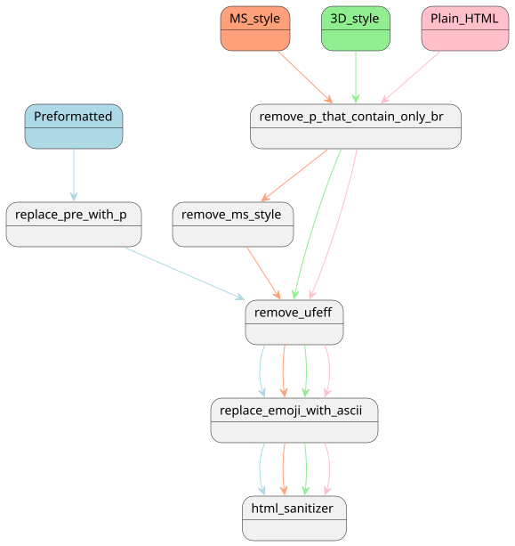

# Clean Processing

## Introduction

The following documents the different styles of message HTML and how they are processed.

## Types of Email message styles

Email clients create HTML and associated styles (or lack there of) that are unique to the client. Whpool messages were analyzed to find distict styles that will need preprocessing before using an HTML sanitizer. Five distinct types have been identified:

- Preformatted
- MS Style
- LTR Style
- 3D Style
- Plain HTML

### Preformatted

Some messages do not create HTML for the messages. These messages are in text only. The extract process takes the plain text from an mbox file places the message inside pre tags.

### MS Style

Microsoft uses a large amount of inline stlyes within messages. These can be created by the client itself or possibly when pasting a messages created in a Word document. A common characteristic is the use of MsoNormal style added to tags and spans. The MsoNormal style sets p tags to a margin of 0px.

### LTR Style

Some clients create inline styles that can be identified by \
 (left to right). Similar to Mso, it sets p tags to a margin of 0px.

### 3D Style

Gmail (and possibly other clients) uses an inline style of 3D.

### Plain HTML

Some clients do not use any inline styles.

## Processing

The diagram below illustrates the stages of the cleaning process.

