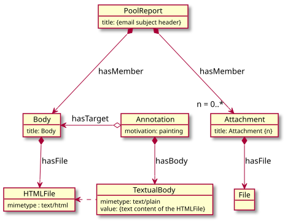

# Full-Text Indexing

Indexing of the pool report body content to support full-text search requires
that the text content of the body pages of the pool reports be copied to a web
annotation describing the page.

The conceptual model looks like this:



The annotation is not done natively by the whpool tool. After running `extract`
and `convert`, and importing the metadata and binaries into the repository, you
will need to use the [Plastron] command-line tool to do the actual annotating.

See these [instructions](Repository.md#setting-up-plastron) for setting up
Plastron.

## Querying Solr

First, get the list of pages that should be annotated by querying Solr. The
query URL will look like this (spaces added for clarity):

```
{SOLR_SERVER}/solr/fedora4/select
    ?fq=collection_title_facet:%22White%20House%20Pool%20Reports%22
    &fq=rdf_type:fabio\:Page
    &q=*:*
    &fl=id
    &rows=100
    &wt=csv
    &csv.header=no
```

| Parameter  | Value | Notes |
|------------|-------|-------|
|`fq`        |`collection_title_facet:%22White%20House%20Pool%20Reports%22`|Limit the query to just the WHCA collection. Quotes and spaces are URL-escaped.|
|`fq`        |`rdf_type:fabio\:Page`|Further limit the query to just resources with the RDF type `fabio:Page`. Both the body and attachments of the email are modelled using this class.| 
|`q`         |`*:*`  |Return every result (that matched thew `fq` clauses|
|`fl`        |`id`   |Only return the id (URL) of each page|
|`rows`      |`100`  |Return 100 rows. Increase if you have more pages you want to annotate.|
|`wt`        |`csv`  |Format output as CSV|
|`csv.header`|`no`   |Don't write a header line for the CSV|

## Annotate the Pages

Pipe the results of the Solr query through `xargs` to the Plastron `annotate`
command:

```bash
curl -s '{SOLR_QUERY_URL}' | xargs plastron -c config.yml -v annotate
```

[Plastron]: https://github.com/umd-lib/plastron
