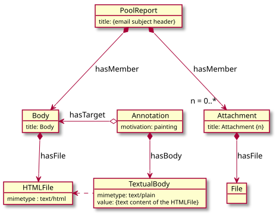
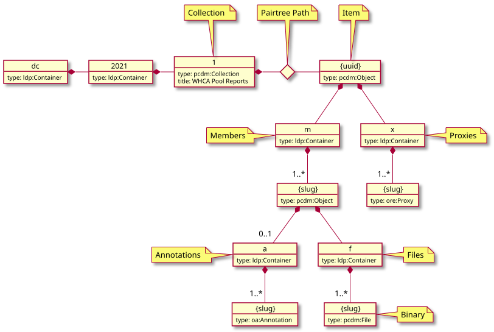

# Pool Reports in the Repository

## Importing

After running extract and convert on a given batch of pool reports, the next
step is to import them into the Fedora repository. This is currently done with
the [Plastron] command-line tool.

### Setting Up Plastron

ℹ️ These setup instructions are for fcrepo-test.lib.umd.edu. For other servers,
substitute the appropriate hostname in the `REST_ENDPOINT` config value and the
URL to obtain the `AUTH_TOKEN` from.

```bash
# requires Python 3.6+
pyenv install 3.6.2
pyenv shell 3.6.2

# clone and install dependencies
git clone git@github.com:umd-lib/plastron.git
cd plastron
pip install -e .
```

Create a `plastron.yml` for Plastron in your home directory that looks like the
following:

```yaml
REPOSITORY:
  REST_ENDPOINT: https://fcrepo-test.lib.umd.edu/rest
  RELPATH: /pcdm
  AUTH_TOKEN: ...
  STRUCTURE: hierarchical
  LOG_DIR: logs
```

Get the `AUTH_TOKEN` by going to <https://fcrepo-test.lib.umd.edu/user> and
generating a new token with the subject "plastron".

### Running the Import

Assuming you have an extracted and converted pool reports batch in the directory
`~/whpool-data`, with a converted CSV metadata file `import.csv`, and an
existing target collection in the repository at `/dc/2021/1`, the import command
will look like this:

```
plastron -c ~/plastron.yml -v import \
    --model Item \
    --member-of https://fcrepo-test.lib.umd.edu/rest/dc/2021/1 \
    --container /dc/2021/1 \
    --binaries-location ~/whpool-data \
    ~/whpool-data/import.csv
```

## Full-Text Indexing

See [FullTextIndexing.md](FullTextIndexing.md)

## RDF Model



[Full-text search](FullTextIndexing.md) is implemented by indexing the
annotation body values in Solr.

## LDP Structure



## Generating Diagrams

To update the generated SVG of these diagrams, use [PlantUML]:

```bash
java -jar plantuml.jar -tsvg FILENAME.txt
```

This will create `FILENAME.svg` from `FILENAME.txt`.

### Source Files

* [Model.txt](Model.txt)
* [Structure.txt](Structure.txt)

[Plastron]: https://github.com/umd-lib/plastron
[PlantUML]: https://plantuml.com/